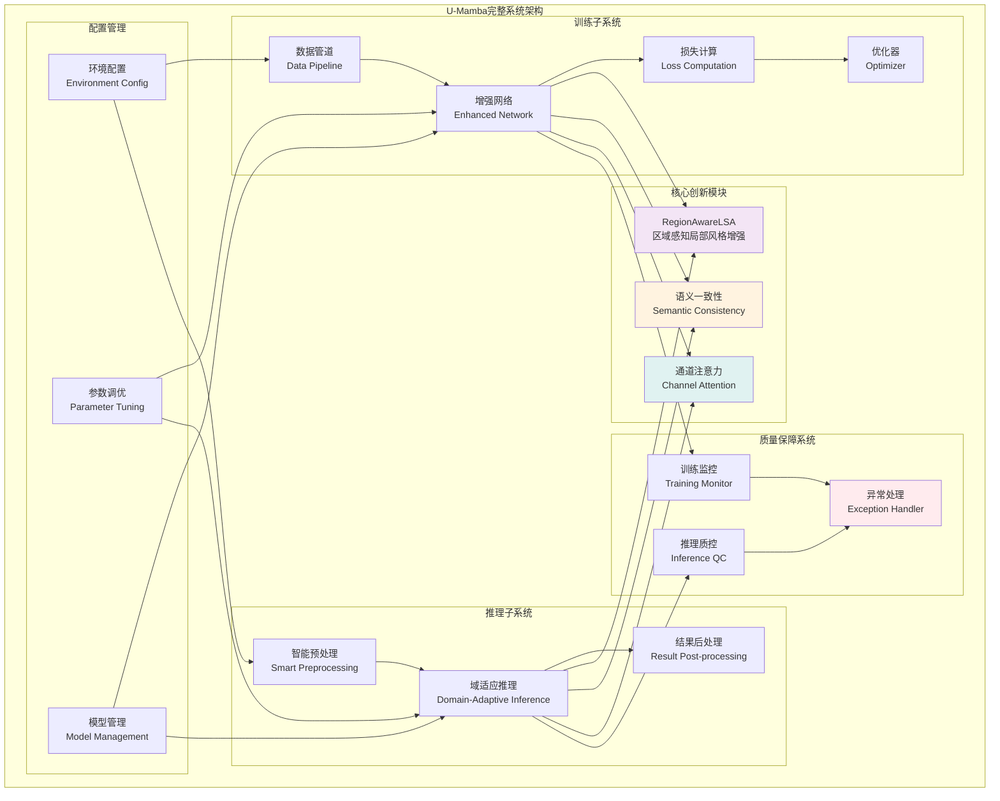

# U-Mamba完整框架：训练与推理一体化架构

## 1. 训练阶段架构

```mermaid
graph TB
    subgraph "训练阶段 Training Phase"
        subgraph "数据准备"
            A[训练数据集<br/>BraTS Training Data]
            B[数据增强<br/>Data Augmentation]
            C[标准化处理<br/>Normalization]
        end
        
        subgraph "增强U-Mamba网络"
            D[编码器<br/>Encoder with Mamba+LSA]
            E[解码器<br/>Decoder]
            
            subgraph "MambaLayer增强"
                F[LayerNorm]
                G[RegionAwareLSA<br/>LSA + Channel Attention]
                H[Mamba Block]
            end
        end
        
        subgraph "双前向传播训练"
            I[前向传播1<br/>Forward Pass 1 (梯度)]
            J[前向传播2<br/>Forward Pass 2 (无梯度)]
            K[分割损失<br/>Segmentation Loss]
            L[语义一致性损失<br/>Consistency Loss]
            M[总损失<br/>Combined Loss]
        end
        
        subgraph "模型优化"
            N[反向传播<br/>Backpropagation]
            O[参数更新<br/>Parameter Update]
            P[样式库更新<br/>Style Bank Update]
        end
    end
    
    A --> B --> C --> D
    D --> E
    D --> F --> G --> H --> E
    
    D --> I
    D --> J
    I --> K
    J --> K
    I --> L
    J --> L
    K --> M
    L --> M
    M --> N --> O
    G --> P
    
    style G fill:#f3e5f5
    style L fill:#fff3e0
    style M fill:#ffebee
```

## 2. 推理阶段架构

```mermaid
graph TB
    subgraph "推理阶段 Inference Phase"
        subgraph "外部数据输入"
            A[外部测试数据<br/>External Test Data]
            B[多域数据<br/>Multi-domain Data]
        end
        
        subgraph "智能预处理系统"
            C[数据状态检测<br/>Data Status Detection]
            D[标准化判断<br/>Normalization Decision]
            E[失帧检测<br/>Missing Frame Detection]
            F[自适应处理<br/>Adaptive Processing]
        end
        
        subgraph "增强推理引擎"
            G[LSA激活推理<br/>LSA-Activated Inference]
            H[域适应机制<br/>Domain Adaptation]
            I[5折模型集成<br/>5-Fold Ensemble]
        end
        
        subgraph "后处理优化"
            J[概率融合<br/>Probability Fusion]
            K[形态学优化<br/>Morphological Optimization]
            L[医学先验约束<br/>Medical Prior Constraints]
        end
        
        M[最终分割结果<br/>Final Segmentation]
    end
    
    A --> C
    B --> C
    C --> D --> F
    C --> E --> F
    F --> G --> H --> I
    I --> J --> K --> L --> M
    
    style C fill:#e1f5fe
    style G fill:#e8f5e8
    style H fill:#f3e5f5
    style I fill:#fff8e1
```



## 3. LSA+语义一致性+通道注意力详细机制

```mermaid
graph TB
    subgraph "核心创新机制详解"
        subgraph "RegionAwareLSA模块"
            A[输入特征<br/>[B, L, C]]
            B[特征统计计算<br/>Compute Statistics]
            C[样式库机制<br/>Style Bank System]
            D[AdaIN变换<br/>Adaptive Instance Normalization]
            
            subgraph "通道注意力子模块"
                E[全局平均池化<br/>Global Average Pooling]
                F[SE-Net结构<br/>Squeeze-Excitation]
                G[通道权重生成<br/>Channel Weight Generation]
            end
            
            H[重要性掩码<br/>Importance Masking]
            I[风格增强融合<br/>Style-Enhanced Fusion]
        end
        
        subgraph "语义一致性训练"
            J[双路径前向<br/>Dual-Path Forward]
            K[概率分布计算<br/>Probability Distribution]
            L[一致性损失<br/>MSE Consistency Loss]
            M[权重平衡<br/>Loss Weighting: λ=0.05]
        end
        
        subgraph "训练推理协同"
            N[训练时增强<br/>Training Augmentation]
            O[推理时适应<br/>Inference Adaptation]
            P[跨域泛化<br/>Cross-Domain Generalization]
        end
    end
    
    A --> B --> C --> D
    A --> E --> F --> G --> H
    D --> I
    H --> I
    
    I --> J --> K --> L --> M
    
    N --> O --> P
    I --> N
    L --> O
    
    style D fill:#f3e5f5
    style G fill:#e0f2f1
    style L fill:#fff3e0
    style P fill:#e8f5e8
```

## 4. 系统集成架构



## 5. 关键技术对比

| 技术组件 | 原始U-Mamba | 增强版U-Mamba | 改进效果 |
|---------|-------------|---------------|----------|
| **骨干网络** | Mamba Block | Mamba + LSA + 通道注意力 | 增强特征表达 |
| **训练策略** | 单次前向传播 | 双前向传播 + 语义一致性 | 提升泛化能力 |
| **推理机制** | 标准推理 | 智能预处理 + 域适应 | 跨域适应性 |
| **注意力机制** | 无 | SE-style通道注意力 | 特征重标定 |
| **风格增强** | 无 | RegionAwareLSA | 域间适应 |
| **数据处理** | 固定标准化 | 智能检测 + 自适应处理 | 处理灵活性 |

## 6. 实施建议

### 训练阶段优化
1. **LSA模块配置**: p=0.5, 样式库大小=2048
2. **一致性损失权重**: λ=0.05
3. **通道注意力压缩比**: reduction_ratio=8

### 推理阶段优化  
1. **智能检测阈值**: mean∈(-15,0), std∈(1,5)
2. **LSA推理激活**: p=0.8, training=True
3. **多尺度融合**: [0.25, 0.5, 0.25]权重

### 部署配置
1. **环境变量**: NNUNET_SKIP_NORMALIZATION
2. **模型集成**: 5折交叉验证模型
3. **异常处理**: 智能降级策略