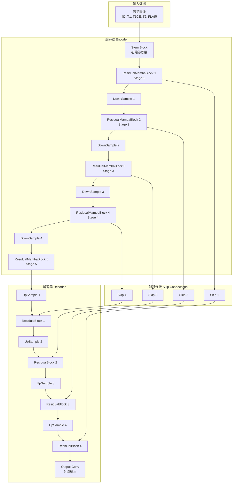

# U-Mamba增强框架：LSA+语义一致性训练+通道注意力机制

## 1. 增强版U-Mamba网络架构



## 2. 增强MambaLayer详细结构

```mermaid
graph TB
    subgraph "增强版MambaLayer"
        A[输入特征<br/>Shape: [B, D, H, W, C]]
        B[Reshape<br/>[B, D*H*W, C]]
        C[Layer Normalization]
        
        subgraph "RegionAwareLSA模块"
            D[计算特征统计<br/>Mean & Std]
            E{训练模式?}
            F[样式库采样<br/>Style Bank Sampling]
            G[AdaIN变换<br/>风格迁移]
            H[通道注意力<br/>Channel Attention]
            I[重要性掩码<br/>Importance Mask]
            J[风格增强融合<br/>Style Enhancement]
        end
        
        K[Mamba Block<br/>状态空间模型]
        L[Reshape<br/>[B, D, H, W, C]]
        M[输出特征]
    end
    
    A --> B --> C --> D
    D --> E
    E -->|训练| F
    E -->|推理| M
    F --> G --> H --> I --> J --> K
    C -->|残差连接| K
    K --> L --> M
    
    style D fill:#e1f5fe
    style H fill:#f3e5f5
    style J fill:#e8f5e8
```

## 3. 语义一致性训练机制

```mermaid
graph TB
    subgraph "双前向传播训练"
        A[输入Batch]
        B[网络前向传播1<br/>（有梯度）]
        C[网络前向传播2<br/>（无梯度）]
        
        D[输出1<br/>Output1]
        E[输出2<br/>Output2]
        
        F[分割损失1<br/>Seg Loss1]
        G[分割损失2<br/>Seg Loss2]
        
        H[Softmax概率1<br/>Prob1]
        I[Softmax概率2<br/>Prob2]
        
        J[语义一致性损失<br/>MSE(Prob1, Prob2)]
        
        K[总损失<br/>L = 0.5*(L1+L2) + λ*Consistency]
        L[反向传播]
    end
    
    A --> B
    A --> C
    B --> D --> F
    B --> D --> H
    C --> E --> G
    C --> E --> I
    
    H --> J
    I --> J
    
    F --> K
    G --> K
    J --> K
    K --> L
    
    style J fill:#fff3e0
    style K fill:#ffebee
```

## 4. 通道注意力机制详情

```mermaid
graph TB
    subgraph "SE-Style通道注意力"
        A[输入特征<br/>[B, L, C]]
        B[全局平均池化<br/>Global Average Pooling]
        C[降维线性层<br/>Linear(C, C//8)]
        D[ReLU激活]
        E[升维线性层<br/>Linear(C//8, C)]
        F[Sigmoid激活]
        G[通道权重<br/>[B, C]]
        H[权重重塑<br/>[B, 1, C]]
        I[特征重标定<br/>Feature Recalibration]
        J[输出特征]
    end
    
    A --> B --> C --> D --> E --> F --> G --> H
    A --> I
    H --> I --> J
    
    style B fill:#e3f2fd
    style G fill:#f1f8e9
    style I fill:#fce4ec
```

## 5. RegionAwareLSA完整流程

```mermaid
graph TB
    subgraph "RegionAwareLSA详细流程"
        A[输入特征 x<br/>[B, L, C]]
        B{训练模式检查}
        C[随机概率检查<br/>p=0.5]
        D[计算统计量<br/>Mean & Std]
        
        subgraph "样式采样策略"
            E{Batch Size > 1?}
            F[批内随机排列<br/>Within-batch Permutation]
            G[样式库采样<br/>Style Bank Sampling]
            H[DDP同步采样<br/>Multi-GPU Sync]
        end
        
        I[AdaIN变换<br/>Adaptive Instance Norm]
        J[通道注意力计算<br/>Channel Attention]
        K[重要性掩码<br/>importance_mask]
        L[增强掩码<br/>augment_mask = 1-importance]
        M[可学习权重γ<br/>Per-channel Gamma]
        N[最终融合<br/>x*importance + x_aug*augment*γ]
        O[样式库更新<br/>Style Bank Update]
        P[输出特征]
    end
    
    A --> B
    B -->|训练| C
    B -->|推理| P
    C -->|通过| D
    C -->|跳过| P
    
    D --> E
    E -->|是| F
    E -->|否| G
    G --> H
    
    F --> I
    H --> I
    I --> J --> K --> L
    D --> M --> N
    K --> N
    L --> N
    N --> O --> P
    
    style D fill:#e8eaf6
    style I fill:#f3e5f5
    style J fill:#e0f2f1
    style N fill:#fff8e1
```