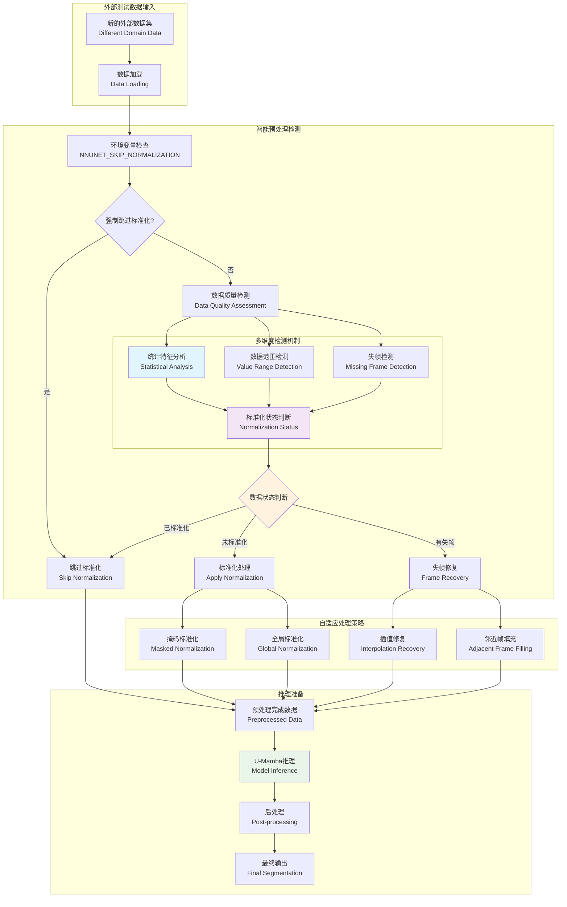
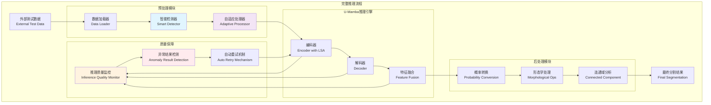
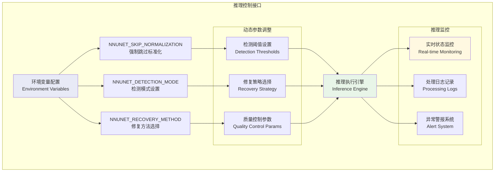

# 智能推理预处理框架：数据标准化检测与处理

## 1. 推理时数据预处理完整流程



## 2. 数据状态智能检测算法

```mermaid
graph TB
    subgraph "数据标准化状态检测"
        A[输入医学图像<br/>Input Medical Image]
        B[计算全局统计量<br/>Global Statistics]
        C[计算掩码统计量<br/>Masked Statistics]
        
        subgraph "多重检测条件"
            D[均值范围检测<br/>-15 < mean < 0]
            E[标准差范围检测<br/>1.0 < std < 5.0]
            F[数据范围检测<br/>(max-min) < 50]
            G[原始数据排除<br/>Non-raw Medical Range]
        end
        
        H[综合判断<br/>Combined Decision]
        I{是否已标准化?}
        J[返回: 已标准化<br/>Skip Normalization]
        K[返回: 需标准化<br/>Apply Normalization]
    end
    
    A --> B
    A --> C
    B --> D
    B --> E
    B --> F
    C --> D
    C --> E
    C --> F
    B --> G
    C --> G
    
    D --> H
    E --> H
    F --> H
    G --> H
    
    H --> I
    I -->|是| J
    I -->|否| K
    
    style D fill:#e8eaf6
    style E fill:#e8eaf6
    style F fill:#e8eaf6
    style G fill:#e8eaf6
    style H fill:#fff8e1
```

## 3. 失帧检测与修复机制

```mermaid
graph TB
    subgraph "失帧检测与处理"
        A[3D医学图像<br/>Shape: [D, H, W]]
        B[逐层分析<br/>Slice-wise Analysis]
        C[异常检测<br/>Anomaly Detection]
        
        subgraph "失帧类型判断"
            D[全零切片检测<br/>Zero Slice Detection]
            E[异常值切片检测<br/>Outlier Slice Detection]
            F[不连续切片检测<br/>Discontinuity Detection]
        end
        
        subgraph "修复策略选择"
            G[线性插值<br/>Linear Interpolation]
            H[三次样条插值<br/>Cubic Spline]
            I[邻近切片复制<br/>Adjacent Copy]
            J[深度学习修复<br/>DL-based Inpainting]
        end
        
        K[质量验证<br/>Quality Validation]
        L[修复完成<br/>Recovery Complete]
    end
    
    A --> B --> C
    C --> D
    C --> E
    C --> F
    
    D --> G
    E --> H
    F --> I
    D --> J
    E --> J
    F --> J
    
    G --> K
    H --> K
    I --> K
    J --> K
    K --> L
    
    style C fill:#ffebee
    style G fill:#e8f5e8
    style H fill:#e8f5e8
    style I fill:#e8f5e8
    style J fill:#e8f5e8
```

## 4. 推理流程集成架构



## 5. 环境配置与控制接口

