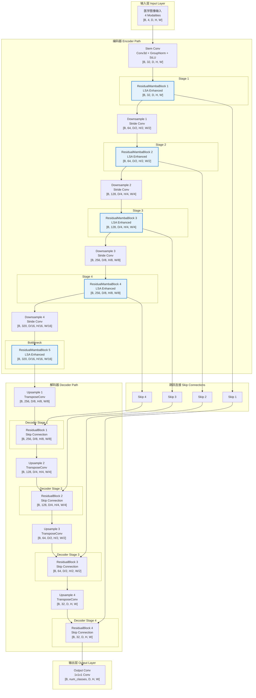
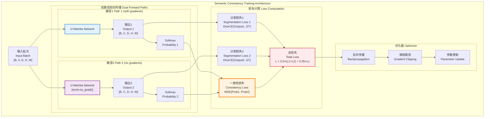
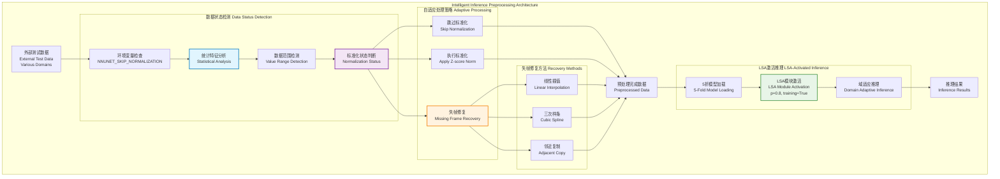
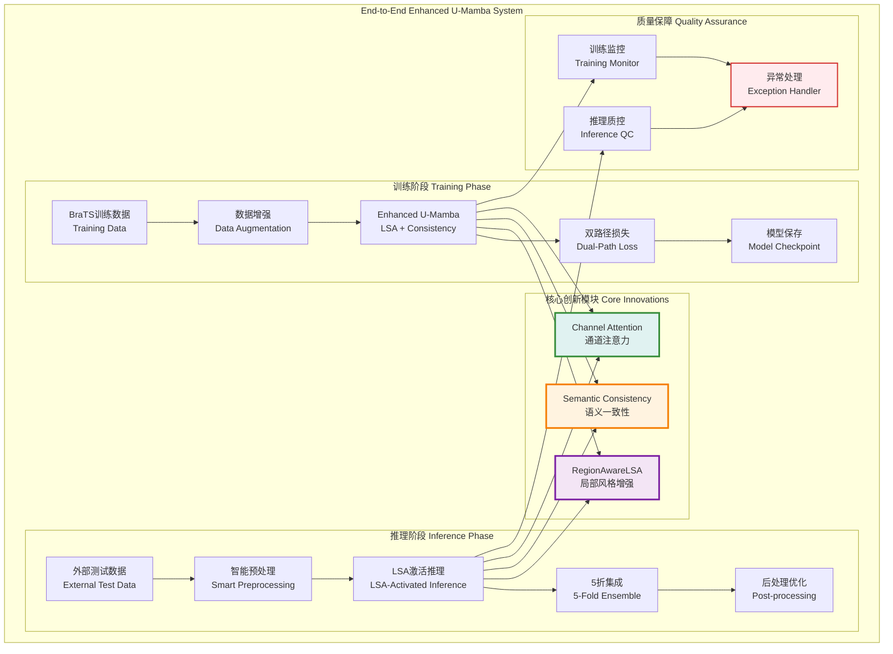
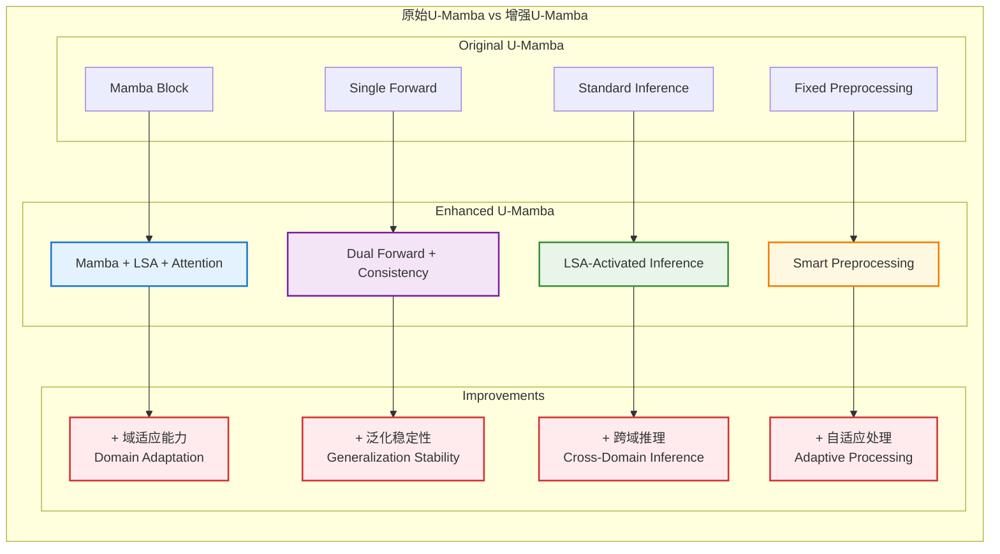

# U-Mamba增强网络架构图：LSA+语义一致性+通道注意力

## 1. 增强版U-Mamba完整网络架构

## 2. 增强版MambaLayer详细结构

```mermaid
graph TB
    subgraph "Enhanced MambaLayer Architecture"
        A["输入特征<br/>[B, C, D, H, W]"]
        
        subgraph "预处理 Preprocessing"
            B["Reshape<br/>[B, C, D×H×W] → [B, D×H×W, C]"]
            C["Layer Normalization<br/>LayerNorm(C)"]
        end
        
        subgraph "RegionAwareLSA Module"
            D["特征统计计算<br/>Mean & Std per Sample"]
            
            subgraph "样式增强 Style Enhancement"
                E["样式库采样<br/>Style Bank Sampling"]
                F["AdaIN变换<br/>Adaptive Instance Norm"]
            end
            
            subgraph "通道注意力 Channel Attention"
                G["全局平均池化<br/>Global Average Pooling"]
                H["SE模块<br/>Linear→ReLU→Linear→Sigmoid"]
                I["通道权重<br/>Channel Weights [B, C]"]
            end
            
            J["重要性掩码<br/>Importance Masking"]
            K["风格融合<br/>Style Fusion with γ"]
        end
        
        subgraph "Mamba处理 Mamba Processing"
            L["Mamba Block<br/>State Space Model"]
            M["选择性扫描<br/>Selective Scan"]
            N["输出投影<br/>Output Projection"]
        end
        
        subgraph "后处理 Postprocessing"
            O["Reshape<br/>[B, D×H×W, C] → [B, C, D, H, W]"]
            P["残差连接<br/>Residual Connection"]
        end
        
        Q["输出特征<br/>[B, C, D, H, W]"]
    end
    
    A --> B --> C --> D
    D --> E --> F
    D --> G --> H --> I --> J
    F --> K
    I --> K
    C --> L
    K --> L --> M --> N --> O
    A --> P
    O --> P --> Q
    
    style D fill:#f3e5f5,stroke:#7b1fa2,stroke-width:2px
    style H fill:#e0f2f1,stroke:#388e3c,stroke-width:2px
    style K fill:#fff8e1,stroke:#f57c00,stroke-width:2px
    style L fill:#e1f5fe,stroke:#0277bd,stroke-width:2px
```

## 3. 语义一致性训练架构

## 4. 智能推理预处理架构

## 5. 端到端系统架构

## 6. 关键技术对比图

这些架构图采用了类似于原始U-Mamba-network.png的风格，展现了：

1. **完整网络架构** - 编码器-解码器结构与跳跃连接
2. **增强MambaLayer** - LSA+通道注意力的详细结构
3. **语义一致性训练** - 双路径前向传播机制
4. **智能推理预处理** - 数据检测与自适应处理
5. **端到端系统** - 训练与推理的完整流程
6. **技术对比** - 原始vs增强版的改进点

每个图都突出了您的三大创新点：LSA、语义一致性训练和通道注意力机制，并且采用了清晰的模块化设计和专业的配色方案。